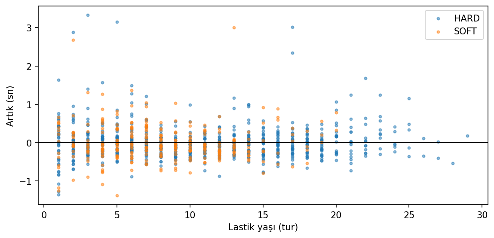

# f1-strategy

Gerçek Formula 1 yarış verilerinden lastik aşınmasını (tyre degradation) istatistiksel olarak modelleyen ve pit-stop stratejilerini belirsizlik altında karşılaştırmayı hedefleyen veri analizi projesi.

Kısaca soru: bir yarışta 1 pit mi yoksa 2 pit mi yapmak daha avantajlı ve bu sonuçtan ne kadar emin olabiliriz?

## Proje Durumu

- [x] **Adım 1:** OpenF1 REST API üzerinden 2024 Bahreyn GP tur ve stint verilerinin çekilmesi.
- [x] **Adım 2:** İlk tur, pit turları ve aykırı turların temizlenmesi.
- [x] **Adım 3:** Sabit etkili çoklu regresyon (OLS) ile bileşik bazlı aşınma modellemesi, sürücüye göre kümelenmiş standart hatalar, R ile çapraz doğrulama ve aykırı değer duyarlılık analizi.
- [ ] **Adım 4:** Tahmin edilen parametrelerle vektörize Monte Carlo pit-stop strateji simülatörü (1-stop vs. 2-stop).

## Veri

[OpenF1](https://openf1.org) açık API'sinden `laps` ve `stints` verileri çekilir. Bahreyn 2024 yarışında yalnızca HARD ve SOFT lastik kullanılmıştır. İlk tur, pit giriş ve çıkış turları ve eksik süreler çıkarılır; medyanın %107'sinden yavaş turlar elenir (1129 turdan 1024'ü kalır).

## Model

```text
tur_süresi = sürücü_etkisi + bileşik_etkisi
           + (bileşiğe özel aşınma eğimi × lastik_yaşı)
           + (yakıt_etkisi × tur_no) + hata
```

Model `statsmodels` ile OLS olarak kurulur. Aynı sürücünün turları birbirine bağımlı olduğu için standart hatalar sürücüye göre kümelenerek de hesaplanır.

## Bulgular (2024 Bahreyn GP)

| Bileşik | Aşınma (sn/tur) | SE (klasik) | SE (kümelenmiş) | %95 güven aralığı |
|---------|-----------------|-------------|-----------------|-------------------|
| HARD    | 0,111           | 0,0030      | 0,0039          | 0,102 – 0,119     |
| SOFT    | 0,130           | 0,0066      | 0,0142          | 0,100 – 0,160     |

- SOFT için kümelenmiş SE klasik SE'nin yaklaşık 2,2 katıdır; klasik yöntem belirsizliği olduğundan küçük gösteriyordu.
- Klasik standart hatalarla yapılan önceki analizde SOFT–HARD eğim farkı anlamlı bulunmuştu (`p = 0,0051`). Aynı test kümelenmiş SE ile henüz tekrarlanmadı; güven aralıkları ise büyük ölçüde örtüşüyor.
- Yakıt azalması + pist evrimi: tur başına yaklaşık −0,071 sn (%95 GA: −0,077 ile −0,066).
- Tur başına artık standart sapma: 0,459 sn
- R² = 0,871 (sürücü etkileri dahil), n = 1024 temiz tur, 20 sürücü.



## Sınırlılıklar

- Tek yarış üzerinden kurulduğu için diğer pistlerle kıyaslanamaz.
- Hava durumu ve trafik modelde yok.
- Yakıt etkisi ile pist gelişimi ayrışmıyor; `tur_no` ikisini birlikte taşır.
- Sürücü sayısı (20) kümelenmiş standart hatalar için sınırda bir küme sayısıdır.
- SOFT lastikle atılan tur sayısı az (293), bu yüzden SOFT tahmini daha belirsizdir.

## Nasıl çalıştırılır

```bash
git clone https://github.com/emirsoenmez9/f1-strategy.git
cd f1-strategy
python3 -m venv venv
source venv/bin/activate
pip install -r requirements.txt

python src/fetch_data.py   # 1) OpenF1'den veriyi çek  -> data/raw/
python src/clean_data.py   # 2) temizle                -> data/processed/
python src/fit_model.py    # 3) modeli kur             -> data/processed/, results/
```

Başka bir yarış için: `python src/fetch_data.py --year 2024 --country Bahrain` (ülke adı OpenF1'deki yazımıyla). Aynı `--year` ve `--country` değerlerini diğer iki adıma da ver.

## Klasör Yapısı

```text
f1-strategy/
├── src/                     # Veri çekme, temizleme ve model betikleri
├── data/raw/                # Ham veri (OpenF1)
├── data/processed/          # Temiz veri ve model parametreleri (JSON)
├── results/                 # Grafik ve katsayı tablosu
├── notebooks/               # İlk keşif notebook'u
├── reports/                 # R ile istatistiksel doğrulama raporu
└── requirements.txt         # Python bağımlılıkları
```
